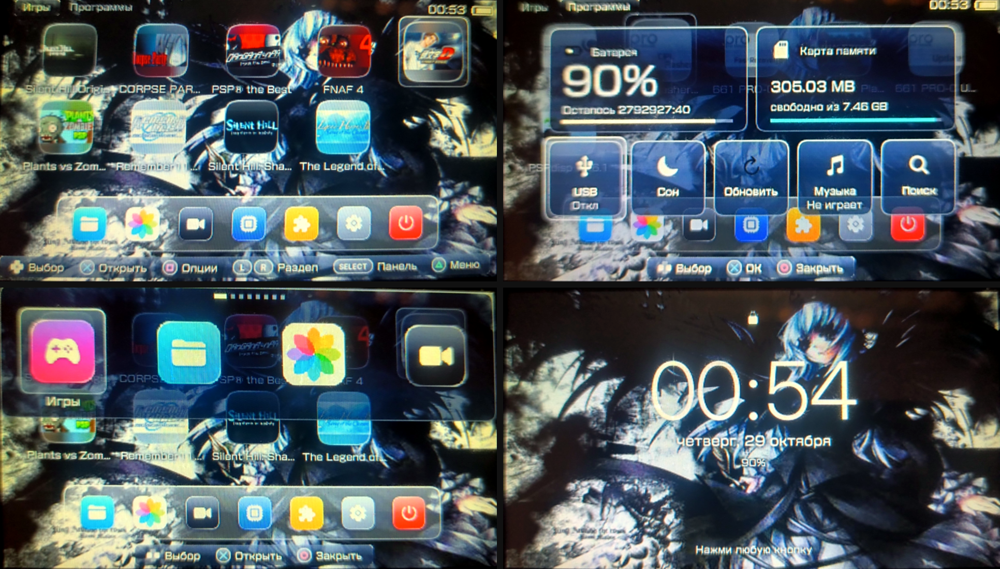

# Yasura 🌸

Моя прошивка для PSP Street (E1000) на 6.61. Основа обычный [ARK-4](https://github.com/PSP-Archive/ARK-4), а сверху я переделал меню так, чтобы оно было похоже на айфон: стеклянная тема, иконки сеткой, док снизу, пункт управления, фото, видео и всякие анимации.

Захотелось, чтобы старая PSP выглядела посвежее, вот и получилось вот это 🙂

📦 **Скачать:** [Yasura-E1000.zip](https://github.com/supchekl/yasura/raw/main/release/Yasura-E1000.zip)

Так это выглядит на моей PSP:



## Что тут есть

- 📱 Главный экран как на айфоне. Игры лежат сеткой по 10 штук на страницу с нормальными названиями, остальные приложения в доке снизу. Разделы Игры / Программы / PS1 переключаются на L и R.
- 🎨 Тема Liquid Glass: яркие обои и стеклянные панели. Значки рисовал по Ionicons.
- 🎛️ Пункт управления на SELECT: заряд, температура, место на карте, кнопки USB, сон, обновить список игр, музыка и поиск.
- 🔍 Поиск игр. Пишешь кусок названия, и меню само прыгает к игре.
- 🖼️ Фото: смотришь картинки из папки PICTURE, листаешь, можно слайд-шоу, а на □ ставишь картинку на обои.
- 🎬 Видео: список роликов из папки VIDEO с превьюшками. Играть их лаунчер не умеет, это делает обычный плеер в XMB.
- 🌅 Обои можно выбрать в настройках, и сразу видно, как они будут смотреться. Есть 5 своих и твоя фотка.
- 🔒 Экран блокировки с большими часами, и PSP сама засыпает, если её не трогать (время настраивается, можно выключить совсем).
- 🔔 Уведомления сверху: зарядку воткнули или вытащили, батарея садится, включился USB и т.д.
- 📸 Скриншот на L + R, он сразу появляется в Фото.
- ✨ Анимации: иконки выпрыгивают по очереди, подсветка плавно ездит, пункт управления выезжает сверху, приложения открываются из иконки.
- 💡 Внизу всегда подписано, какая кнопка что делает.
- 🎮 Если нажать на игру, сначала показывается карточка с инфой (тип, ID, размер, путь), а уже потом запуск.

Всё остальное как в ARK-4: ISO/CSO, игры PS1, плагины, VSH-меню. Всякое лишнее для E1000 убрал (сборки под Vita, ARK_DC, ядро 1.50), а Wi-Fi штуки по умолчанию выключены, потому что вайфая на E1000 нет.

## Как поставить 🚀

Нужна PSP-E1000 на официальной 6.61, карта памяти и заряд больше 75%.

1. Скачай архив и распакуй.
2. Скинь содержимое папки `memstick/` в корень карты. Должны появиться `PSP/SAVEDATA/ARK_01234/` и `PSP/GAME/ARK_Loader/`.
3. На PSP запусти «Игра → Memory Stick → ARK Loader».
4. Всё, PSP перезагрузится уже с прошивкой. В «Сведениях о системе» будет написано `6.61 Yasura (ARK-4)`.

Это live-режим: после полного выключения (не сна) прошивка слетает, и ARK Loader надо запустить ещё раз. Во флеш при этом ничего не пишется, так что это безопасно.

Если хочется, чтобы прошивка грузилась сама, можно поставить cIPL: скопируй `extras/ARK_cIPL` в `PSP/GAME/` и запусти его. Только сначала поиграй на live-версии и убедись, что всё ок ⚠️ cIPL пишет во флеш, и если в этот момент сядет батарея, можно получить кирпич, а Pandora на E1000 не спасёт. Если при включении держать Home, загрузится обычная прошивка.

**Если обновляешься со старой версии**, удали старую папку `PSP/SAVEDATA/ARK_01234` целиком и закинь новую, иначе останутся старые настройки меню.

Вернуть обычный XMB вместо моего меню можно в `SETTINGS.TXT`: поменяй `always, launcher, on` на `off`. Для XMB в архиве есть обои в том же стиле, `PICTURE/Yasura_Glass.png`.

## Кнопки 🕹️

Внизу экрана и так всё подписано, но вкратце:

- Главный экран: крестовина выбирает, ✕ открыть игру, □ меню игры, L / R разделы, SELECT пункт управления, △ главное меню.
- Вниз с нижнего ряда попадаешь в док, ↑ или ○ обратно к играм.
- Фото: ✕ открыть, ← → листать, □ на обои, START слайд-шоу, ○ назад.
- L + R вместе: скриншот.
- Настройки: ↑ ↓ выбрать, ← → поменять, ✕ сохранить.
- В XMB SELECT открывает VSH-меню (разгон, USB, перезагрузка).

ISO кидай в папку `ISO/` в корне карты, игры PS1 в `PSP/GAME/`.

## Собрать самому 🛠️

Тут лежит весь код прошивки. Собирал на Ubuntu 24.04:

```bash
git clone --recursive https://github.com/supchekl/yasura
cd yasura
./build-yasura.sh
```

Готовое будет в `dist/`. Меню лежит в `extras/menus/arkMenu/`, тема в `extras/menus/arkMenu/themes/LiquidGlass/`, а картинки темы генерит скрипт `contrib/yasura/gen_theme.py`, там можно поменять цвета и формы.

## Спасибо

Огромное спасибо команде [ARK-4](https://github.com/PSP-Archive/ARK-4), без них ничего бы не было. Их оригинальный README лежит в [README_ARK-4.md](README_ARK-4.md). Иконки по мотивам [Ionicons](https://ionic.io/ionicons).

---

by **Supchekl** 💜
