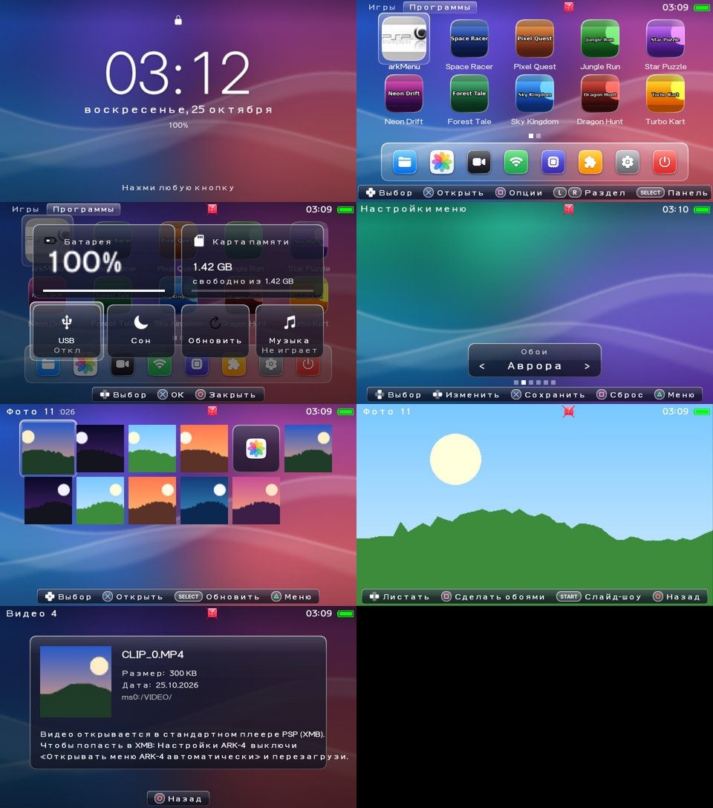
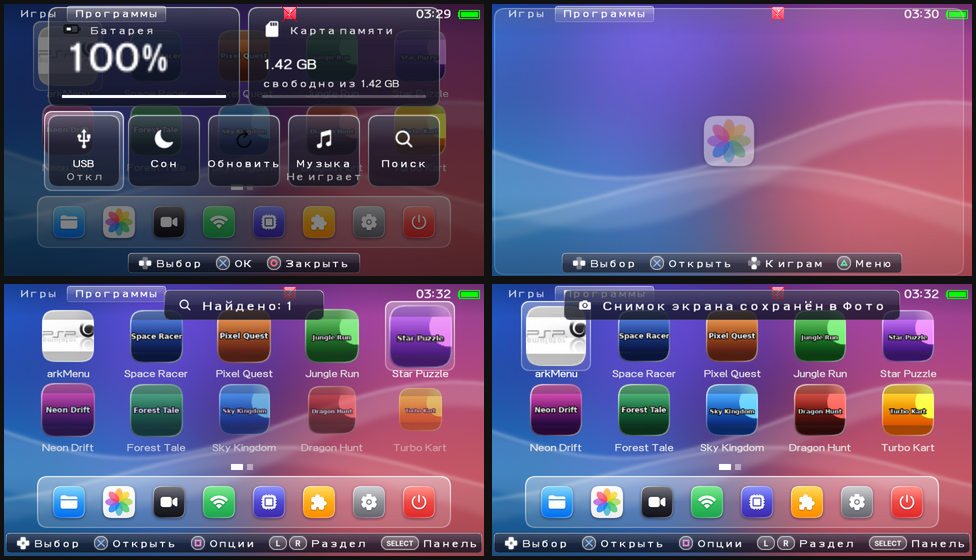

# Yasura 🌸

**Своя прошивка (CFW) для PSP Street (PSP-E1000) на 6.61**, сделанная на основе [ARK-4](https://github.com/PSP-Archive/ARK-4). Лаунчер переделан в стиле iPhone: стеклянная тема, сетка иконок, док, Пункт управления, Фото, Видео, уведомления и плавные анимации.

📦 **Скачать готовую сборку:** [Yasura-E1000.zip](https://github.com/supchekl/yasura/raw/main/release/Yasura-E1000.zip) (папка `release/`)





## ✨ Что внутри

- В «Сведениях о системе» XMB прошивка показывается как `6.61 Yasura (ARK-4)`.
- По умолчанию выключены функции, связанные с Wi-Fi (`wpa2`, `hidemac`), потому что на E1000 Wi-Fi нет.
- 📱 **Домашний экран как на iPhone**, включён по умолчанию: игры показаны сеткой 5×2 из скруглённых иконок с настоящими названиями игр, листаются страницами с точками внизу. Остальные приложения (Файлы, Фото, Видео, Сеть, Настройки ARK, Плагины, Настройки меню, Выход) лежат в стеклянном доке. Сверху прозрачная строка состояния: разделы «Игры / Программы / PS1» слева, время и батарея справа.
- 🎨 Своя тема **Liquid Glass** в стиле iOS 26: яркие обои (синий, фиолетовый, коралловый) со стеклянными лентами и цветные иконки приложений со стеклянным бликом. Значки нарисованы по открытому набору Ionicons (лицензия MIT), который сделан под iOS. Скриншоты ниже.
- Доработан сам лаунчер: панели теперь рисуются без растягивания углов (9-slice), под выбранной игрой появилась стеклянная подложка, текст стал белее, фоновые анимации и мигание текста по умолчанию выключены.
- 🖼️ **Фото**: все снимки из папок `PICTURE` и `PSP/PHOTO` сеткой миниатюр. ✕ открывает снимок на весь экран, ← → листают, START включает слайд-шоу, □ делает снимок обоями. Очень большие фото (больше примерно 1 мегапикселя) PSP не тянет по памяти, они показываются значком.
- 🎬 **Видео**: ролики из папки `VIDEO` с миниатюрами `.THM`, размером и датой. Сам лаунчер видео играть не умеет, MP4 открывает только стандартный плеер PSP в XMB, и карточка видео объясняет, как туда попасть.
- 🌅 **Обои с предпросмотром**: «Настройки меню → Обои». Пока стоишь на этом пункте, список прячется и видно обои целиком, ← → переключают: Yasura, Аврора, Закат, Океан, Ночь и «Моё фото» (снимок, выбранный в «Фото» через □).
- 😴 **Сон при простое**: «Настройки меню → Сон при простое»: никогда, 1, 3, 5, 10, 15 или 30 минут (по умолчанию 10). PSP не засыпает, пока играет музыка, включён USB или открыт экран FTP.
- 🔒 **Экран блокировки**: через 30 секунд без нажатий (меняется в «Настройки меню → Время до фоновой заставки») появляются большие часы, дата и заряд, любая кнопка возвращает обратно.
- 🎛️ **Пункт управления**: SELECT на домашнем экране, выезжает сверху и уезжает обратно. Заряд батареи, сколько осталось и температура, свободное место на карте, кнопки USB, Сон, Обновить список игр, Музыка (пауза) и Поиск.
- ✨ **Плавные анимации как в iOS**: иконки игр всплывают по очереди при входе и смене раздела, подсветка плавно переезжает между иконками и пунктами настроек, страницы листаются сдвигом, док выезжает снизу, приложения из дока раскрываются из своей иконки, фото в просмотре увеличиваются при открытии и въезжают сбоку при листании, экран блокировки уезжает вверх.
- 🔍 **Поиск игр**: «Пункт управления → Поиск», вводишь часть названия, и меню сразу переходит к первой найденной игре в нужном разделе, а сверху пишет, сколько нашлось.
- 🔔 **Уведомления**: стеклянный баннер сверху, как на iPhone. Сообщает, когда подключили или отключили зарядку, когда заряд упал до 20% и 10%, когда включили USB, обновили список игр или поставили обои.
- 📸 **Снимок экрана**: зажми **L + R** вместе в любом месте лаунчера, снимок сохранится в `PICTURE/Yasura/` и сразу появится в «Фото».
- 💡 **Подсказки кнопок** внизу каждого экрана: стеклянная полоска с иконками ✕ ○ △ □ L R SELECT и подписью, что кнопка делает именно здесь. Подсказки меняются, когда открываешь меню или переходишь в другой раздел.
- 🎮 **Карточка игры**: при нажатии ✕ на игре сначала открывается карточка с названием, типом (PSP ISO, PS1, PSN, homebrew), ID игры, размером и путём. ✕ ещё раз запускает игру, ○ возвращает назад.
- Спокойное оформление: выбранный пункт во всех меню подсвечивается стеклянной плашкой вместо мигающего светящегося текста, панели аккуратнее, лишние значки убраны.
- Обои для XMB в том же стиле: `PICTURE/Yasura_Glass.png`.
- Убрано всё, что к E1000 не относится: сборки для PS Vita, ARK_DC (для него нужна Pandora, а E1000 её не поддерживает) и аддон ядра 1.50 (он только для PSP-1000).

Остальное работает как в обычном ARK-4: ISO/CSO, PS1-игры, плагины, VSH-меню, свой лаунчер и темы.

## 🧰 Что нужно

- PSP-E1000 с официальной прошивкой **6.61** (проверить можно в «Настройки → Сведения о системе»). Если прошивка старее, обнови её до 6.61 официальным апдейтом с карты памяти.
- Карта Memory Stick Pro Duo и USB-кабель.
- Батарея заряжена больше чем на 75%.

## 🚀 Установка (live-режим, безопасно)

1. Подключи PSP к компьютеру через «USB-соединение».
2. Скачай [Yasura-E1000.zip](https://github.com/supchekl/yasura/raw/main/release/Yasura-E1000.zip), распакуй и скопируй содержимое папки `memstick/` в корень карты памяти. Получится:
   - `PSP/SAVEDATA/ARK_01234/`
   - `PSP/GAME/ARK_Loader/`
3. На PSP открой «Игра → Memory Stick → ARK Loader».
4. Консоль перезагрузится с CFW. Проверь «Сведения о системе», там должна быть строка `6.61 Yasura (ARK-4)`.

В live-режиме CFW слетает после полного выключения (не «сна»), и тогда ARK Loader нужно запустить заново. Флеш консоли в этом режиме не меняется.

## 🔧 Постоянная установка (cIPL, по желанию)

Новый ARK-4 умеет ставить cIPL на все модели, включая E1000 (11g). После этого CFW загружается сама при включении.

⚠️ **Внимание:** cIPL записывает загрузчик во флеш консоли. Если в процессе сядет батарея или выключится питание, можно получить кирпич, а Pandora на E1000 его не вылечит. Сначала поживи на live-версии и убедись, что всё работает.

1. Загрузи CFW через ARK Loader.
2. Скопируй `extras/ARK_cIPL` в `PSP/GAME/`.
3. Запусти его из XMB и нажми кнопку установки. Удаляется cIPL тем же приложением.
4. Если при включении держать **Home**, загрузится официальная прошивка.

Альтернатива без cIPL: Infinity 2 (https://github.com/DaveeFTW/Infinity), тоже даёт автозагрузку на 6.61.

## 🪟 Стеклянный дизайн

Тема Liquid Glass уже лежит в `ARK_01234/THEME.ARK`, и лаунчер ARK со стеклянным меню включён по умолчанию (`always, launcher, on` в `SETTINGS.TXT`). Чтобы вернуть обычный XMB, поменяй `on` на `off`.

**При обновлении со старой версии** удали старую папку `PSP/SAVEDATA/ARK_01234` целиком и скопируй новую. Лаунчер хранит свои настройки в `ARKMENU.BIN`, и если оставить старый файл, на экране останутся старые настройки, например точки на фоне.

Обои для XMB: открой «Фото → Memory Stick», выбери `Yasura_Glass`, нажми △ и выбери «Установить как обои». Иконки самого XMB стеклянными так не сделать, для этого нужна тема XMB в формате CTF.

Свои обои проще всего поставить через «Фото»: открой снимок и нажми □. Они сохраняются в `PSP/SAVEDATA/ARK_01234/WALL.RAW`. Старый способ тоже работает: PNG 480×272 как `PSP/SAVEDATA/ARK_01234/BG.PNG` и пункт «Моё фото» в обоях.

## 📁 Что в архиве

- `memstick/`: всё, что копируется на карту памяти.
- `extras/ARK_cIPL`, `ARK_Full_Installer`, `ARK_Uninstaller`, `FinalSpeed`: установщики и утилиты ARK-4.
- `extras/themes`: темы для лаунчера, среди них `LiquidGlass`. Чтобы сменить тему, положи нужный `THEME.ARK` в `PSP/SAVEDATA/ARK_01234/`.
- `source/`: патч с изменениями относительно ARK-4 и генератор темы.
- `preview/`: скриншоты.

## 🕹️ Кнопки в лаунчере

Внизу экрана всегда видно, что делает каждая кнопка. Коротко:

- **Домашний экран**: крестовина выбирает игру (вправо с последней иконки листает на следующую страницу), ✕ открывает карточку игры, □ меню игры (информация, переименовать, удалить), **L / R** переключают раздел (Игры, Программы, PS1), SELECT открывает Пункт управления, △ главное меню.
- **Фото**: крестовина выбирает снимок, L / R листают страницами, ✕ открыть, SELECT пересканировать папку. В просмотре ← → листать, □ сделать обоями, START слайд-шоу, ○ назад.
- **Док**: вниз с нижнего ряда иконок, ← → выбрать приложение, ✕ открыть, ↑ или ○ вернуться к играм.
- **Главное меню (△)**: ← → выбрать раздел, ✕ открыть, ○ закрыть.
- **L + R вместе**: снимок экрана в «Фото».
- **Файлы**: ✕ открыть, ○ папка вверх, □ отметить файл, **L** действия (копировать, вырезать, удалить, переименовать, USB).
- **Настройки**: ↑ ↓ выбрать, ← → изменить значение, ✕ сохранить, □ сбросить.

## 📌 Полезное

- **Select** в XMB открывает VSH-меню (разгон, USB-устройство, перезагрузка, Recovery-меню).
- ISO игры кладутся в папку `ISO/` в корне карты, PS1-игры в `PSP/GAME/` в формате EBOOT.

## 🛠️ Собрать из исходников

Это полный исходный код прошивки: ARK-4 с изменениями Yasura. На Ubuntu 24.04:

```bash
git clone --recursive https://github.com/supchekl/yasura
cd yasura
./build-yasura.sh
```

Скрипт ставит родной тулчейн ARK-4 (psp-gcc 4.3.2), `sign_np` и `mkpsxiso` и собирает прошивку. Готовые файлы окажутся в `dist/`.

Где что лежит:

- `extras/menus/arkMenu/`: лаунчер (домашний экран, док, Пункт управления, Фото, Видео, настройки).
- `extras/menus/arkMenu/themes/LiquidGlass/`: тема Liquid Glass.
- `contrib/yasura/gen_theme.py`: генератор темы. Рисует все картинки на Python (Pillow и cairosvg), значки берёт из Ionicons, так что цвета и форму можно поменять прямо в коде.

## 📜 Лицензия и благодарности

Yasura основана на [ARK-4](https://github.com/PSP-Archive/ARK-4) от команды PSP-Archive и распространяется на тех же условиях, что и ARK-4. Оригинальное описание ARK-4 лежит в [README_ARK-4.md](README_ARK-4.md). Значки темы нарисованы по набору [Ionicons](https://ionic.io/ionicons) (MIT).

---

Сделал **Supchekl** 💜
